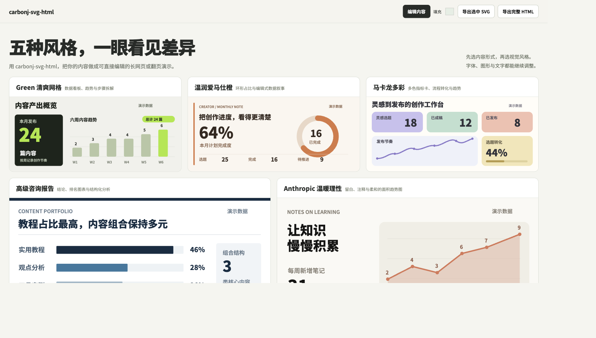
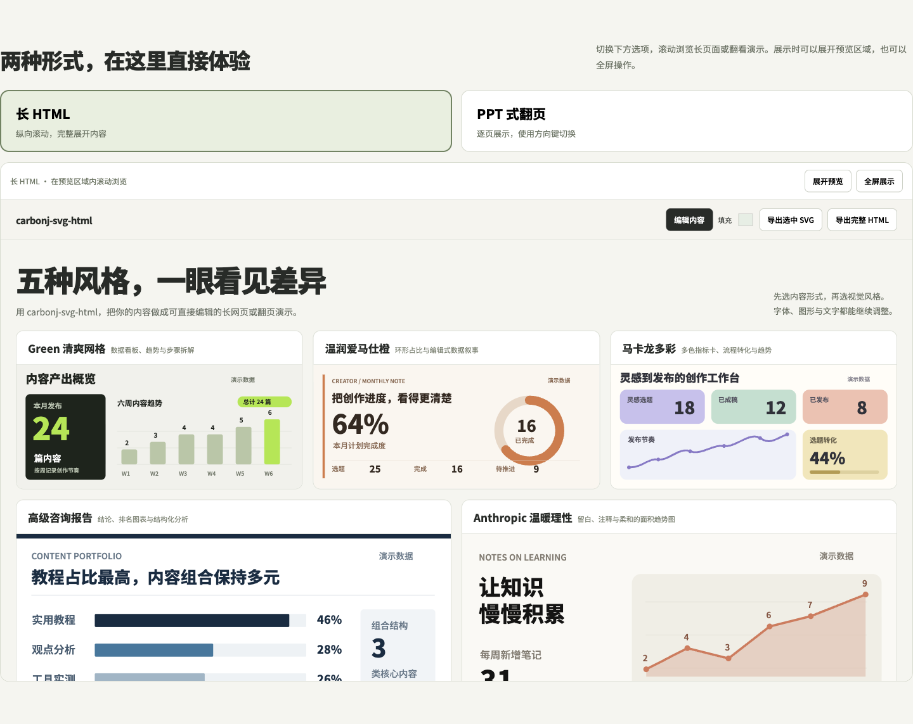
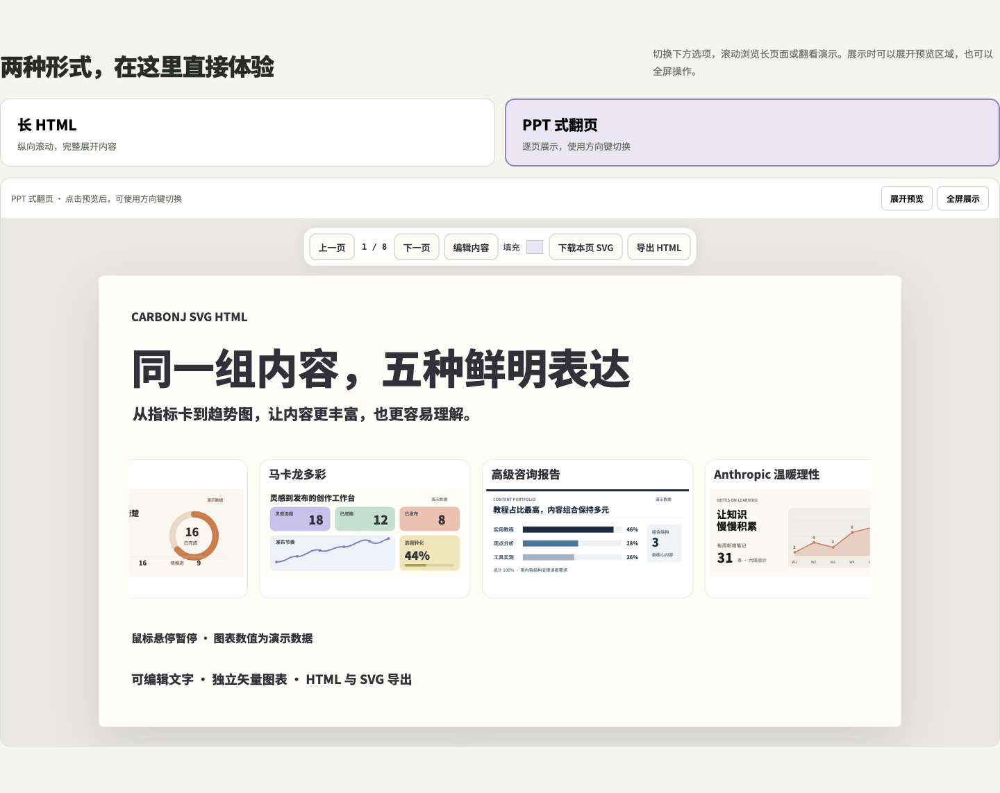
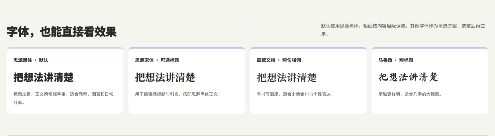
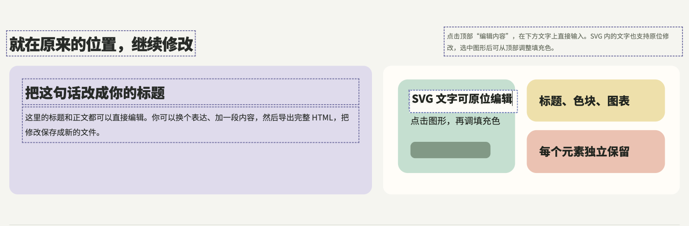

# carbonj-svg-html

把主题、稿件或资料做成可编辑的 SVG HTML 内容。支持纵向滚动的长网页与 PPT 式翻页演示，每次制作先选择内容形式，再选择视觉风格。

An agent skill for editable Chinese SVG HTML pages and slide decks, with five visual systems and in-place browser editing.

## 效果预览

### 五种风格，一眼看见差异

首屏同时呈现 Green 清爽网格、温润爱马仕橙、马卡龙多彩、高级咨询报告与 Anthropic 温暖理性。每种风格都展示实际的指标、图表和文字层级，图中数值为演示数据。



### 长页面与翻页演示，在同一页里切换

介绍页内嵌了两种可操作的示例。长页面可在预览区滚动，PPT 式演示可以逐页切换，还能展开预览或全屏展示。

<table>
  <tr>
    <td width="50%" valign="top">
      <h4>长 HTML</h4>
      <p>连续阅读完整内容，适合教程、介绍和风格展示。</p>
      <a href="docs/screenshots/embedded-long.png"></a>
    </td>
    <td width="50%" valign="top">
      <h4>PPT 式翻页</h4>
      <p>在内嵌区域里切换幻灯片，适合口播和现场分享。</p>
      <a href="docs/screenshots/embedded-ppt.png"></a>
    </td>
  </tr>
</table>

点击图片可以查看大图。

### 字体效果可以直接比较

默认采用思源黑体，并按标题、正文和注释调整字重。字体样张同时展示思源宋体、霞鹜文楷和马善政，便于挑选短标题或强调文字的气质。



### 在文字原来的位置直接修改

开启编辑模式后，HTML 正文直接可输入，SVG 文字在原位置出现光标。图形保持独立，可以选中后从顶部调整填充色，最后导出完整 HTML 或独立 SVG。



## 主要功能

- **两种内容形式**。长 HTML 适合教程、介绍与风格展示，PPT 式 HTML 适合逐页讲解和会议分享。
- **五种视觉方向**。Green 清爽网格、温润爱马仕橙调、马卡龙多彩、高级咨询报告感、Anthropic-inspired 温暖理性。
- **实际样张比较**。选风格时展示真实版式与字体效果，图表、指标卡、表格和流程图保持独立矢量结构。
- **原位编辑**。点击“编辑内容”后，在 HTML 文字上直接输入，SVG 文字在画布原位编辑。选中图形后可调整填充色。
- **HTML 与 SVG 导出**。下载完整可编辑网页，或导出选中的 SVG 图形 / 当前幻灯片。
- **内嵌演示**。介绍页里直接切换、滚动、翻页、展开或全屏展示长网页与 PPT 式预览。

## 安装

将本仓库放进支持本地 Skills 的 Agent 技能目录。Codex 可以使用下列命令。

```bash
git clone https://github.com/CarbonJ-AIEra/carbonj-svg-html.git ~/.codex/skills/carbonj-svg-html
```

已安装时，可以在仓库目录执行 `git pull` 获取更新。刷新技能列表或重启客户端后即可调用。

## 使用

```text
$carbonj-svg-html 帮我做一份关于 AI 工作流的介绍
```

Skill 会询问本次采用长 HTML 还是 PPT 式翻页，再让你比较并选择风格。也可以在需求中给出这些选择。

```text
使用 carbonj-svg-html，做成长 HTML，采用马卡龙风格。
主题是如何用 AI 整理学习笔记，面向普通 AI 用户。
```

```text
使用 carbonj-svg-html，做成 PPT 式翻页，采用高级咨询报告风格。
请根据我提供的资料整理结论、证据与下一步建议。
```

## 查看示例

下载或克隆仓库后，用浏览器打开下列文件。

- [完整长页面示例](assets/long-page-example.html) 包含五种风格样张、字体对照、原位编辑示例和可切换的两种实际演示。
- [八页翻页示例](assets/ppt-style-example.html) 包含风格画廊、字体样张与编辑说明。
- [翻页基础模板](assets/starter.html) 提供可复用的 SVG 画布和编辑交互。

长页面示例里的两个演示使用内嵌 HTML 快照，支持在同一个页面内操作。示例图表标注了“演示数据”，实际制作时采用用户提供的数据与资料。

## 编辑和保存

1. 点击顶部“编辑内容”。
2. 点击文字，在原来的位置输入内容。SVG 文字支持换行，可按 Escape 或点击“完成编辑”结束。
3. 选中图形，从顶部填充控件调整颜色。
4. 点击 SVG 导出按钮，保存选中的图形或当前页。
5. 点击 HTML 导出按钮，将修改保存为新的可编辑文件。

长页面与内嵌演示各自保留编辑控制。完整 HTML 导出会记录已加载内嵌演示中的修改。网页字体通过 Google Fonts 加载，离线打开时浏览器使用系统字体回退。

## 默认字体

全篇默认使用思源黑体对应的 Noto Sans SC，按内容层级调整字重。思源宋体、霞鹜文楷和马善政作为可选的标题或短句字体，只在明确选择后应用。

## 目录

```text
carbonj-svg-html/
├── SKILL.md
├── references/
│   └── style-systems.md
├── assets/
│   ├── editor-runtime.js
│   ├── starter.html
│   ├── long-page-example.html
│   └── ppt-style-example.html
├── docs/
│   └── screenshots/
├── README.md
└── LICENSE
```

## 许可与署名

原创代码与文档采用 [MIT License](LICENSE)，版权署名为 Carbon-J。字体由 Google Fonts 提供，遵循各字体项目的许可。Hermès 和 Anthropic 等名称用于说明视觉参考，相关标识与商标归各自所有者。
