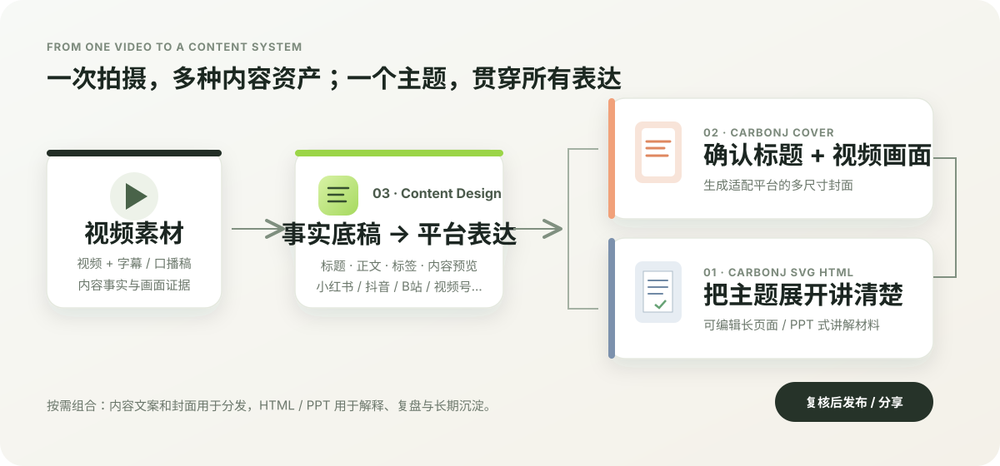
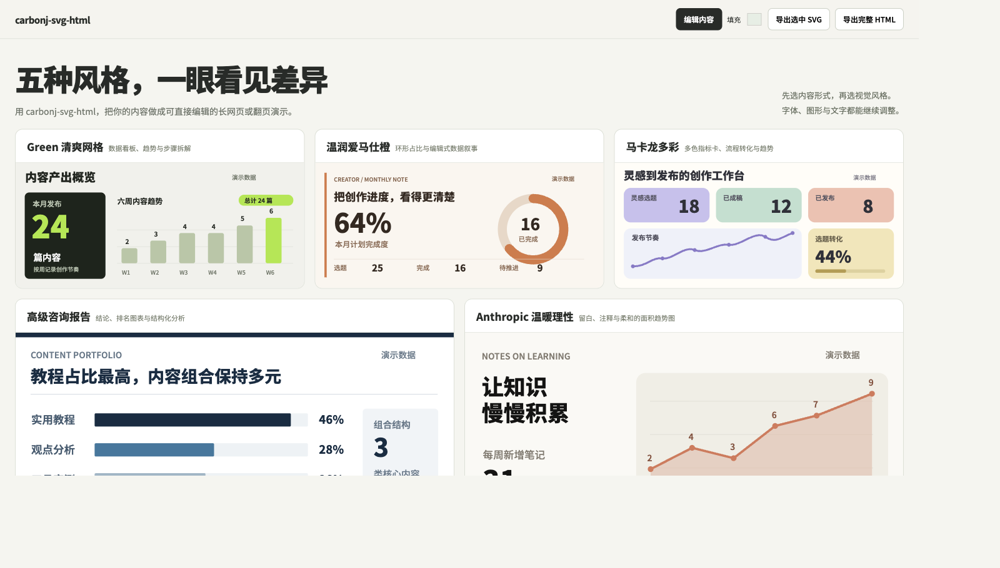
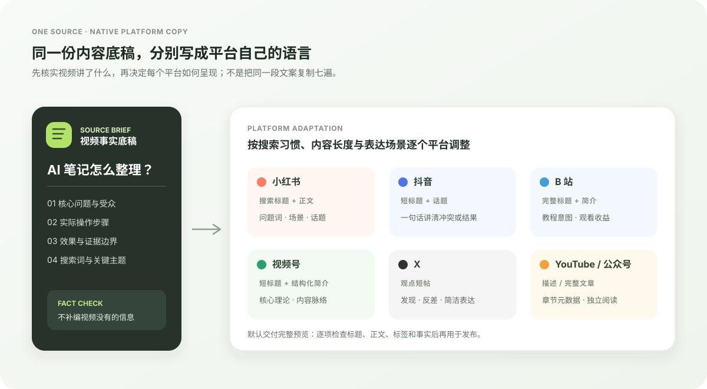

# CarbonJ Content Workflow

**一条视频，延展成多平台内容、统一封面和可继续编辑的讲解材料。**

这里收录了三个 CarbonJ Skills，覆盖自媒体视频从内容梳理到多平台包装的关键环节。它们可以各自独立工作，也可以按创作需要组合使用。

## 三个 Skill 如何组成一套工作流

拍完一条视频后，最花时间的往往不是再剪一次，而是把内容讲清楚、适配不同平台，再为每个平台准备合适的包装。三个 Skill 分别处理这几类工作：

1. **先把视频内容变成可靠的内容底稿。** 提供视频和字幕，或完整口播稿。`carbonj-content-design` 梳理主题、受众、操作步骤、结果和事实依据，再按平台习惯生成标题、正文和标签。
2. **用确认后的标题和视频画面做封面。** `carbonj-cover` 根据标题与视频内容分析画面、挑选适合的素材，并制作小红书、B 站等不同尺寸的封面。
3. **把值得展开的主题做成讲解材料。** `carbonj-svg-html` 将主题、稿件或资料制作为长页面或 PPT 式 HTML，可在页面里直接编辑文字和图形，适合沉淀教程、复盘或分享材料。
4. **人工复核后，带着一套内容去发布和分享。** 检查平台标题、事实、封面和讲解材料，再分别用于对应平台。Skills 负责内容创作，不会替你自动发布。



这不是必须照顺序执行的自动化流水线。只需要平台文案和封面时，可以跳过 HTML；想先做深度讲解材料时，也可以先从 SVG HTML 开始。三个 Skill 共享同一份视频事实与主题信息，减少重复整理，并让各平台文案、封面标题和延展材料围绕同一个内容核心。

## 三个 Skill 分别做什么

### 01 · CarbonJ SVG HTML

**把主题和资料制作成可编辑、可分享的长页面或演示文稿。**



适合把一条视频里的方法、观点或教程整理成更完整的内容资产，例如系列教程、知识介绍页、培训材料或现场演示。开始制作时选择内容形式和视觉风格；完成后可直接在页面上修改 HTML 文字及 SVG 图形，并导出 HTML 或 SVG。

- **输入**：主题、稿件、视频整理出的资料或已有内容。
- **产出**：纵向阅读的长 HTML，或逐页翻看的 PPT 式 HTML。
- **特点**：五种视觉方向；文字与矢量图形可编辑；支持导出。
- **查看 Skill**：[说明与示例](01-carbonj-svg-html/README.md) · [Skill 指令](01-carbonj-svg-html/SKILL.md)

### 02 · CarbonJ Cover

**依据标题和视频画面制作适配不同平台尺寸的封面。**


封面不只换一个比例：Skill 会结合视频实际画面和标题安排视觉重点，让封面内容与视频讲述相符。可使用 Agent 自主流程，也可使用带脚本的生成流程。默认支持小红书 `3:4`、B 站 `4:3` 和 `16:9` 画幅。

- **输入**：视频和确认后的标题；也可以从截图或关键帧开始。
- **产出**：用于不同平台的封面图。
- **特点**：根据视频内容选取画面依据；提供封面视觉规范；支持多种画幅。
- **查看 Skill**：[说明与更多案例](02-carbonj-cover/README.md) · [Skill 指令](02-carbonj-cover/SKILL.md)

### 03 · CarbonJ Content Design

**从同一份视频素材出发，写出符合各平台表达习惯的标题、正文和标签。**



Skill 先通读字幕或口播稿，结合视频确认画面和时间信息，再整理主题、受众、痛点、操作、结果与证据。随后分别适配小红书、抖音、B 站、视频号、X、YouTube 和公众号，不把一篇通稿机械地缩写成七份。默认交付一份七平台内容预览，供发布前检查。

- **输入**：视频及其字幕、视频及指定口播稿，或用户提供的完整文稿。
- **产出**：各平台独立的标题、正文和标签；视频号还包括短标题、长标题等字段。
- **特点**：保留事实边界；考虑搜索关键词和平台格式；默认只生成预览，不上传草稿、不发布。
- **查看 Skill**：[Skill 指令](03-carbonj-content-design/SKILL.md) · [平台规则](03-carbonj-content-design/references/platform-rules.md)

## 一次创作的实际用法

假设你录制了一条“如何用 AI 整理学习笔记”的视频：

1. 把视频和字幕交给 **Content Design**，先得到事实底稿，再得到七个平台各自的标题、正文和标签。
2. 从视频文案中挑选并确认封面主题句，再把视频和标题交给 **Cover**，生成对应平台尺寸的封面。
3. 如果这套方法值得长期沉淀，把主题和整理好的步骤交给 **SVG HTML**，制作可编辑的教程长页面；需要讲解时则选择 PPT 式翻页演示。
4. 人工检查文案与封面是否一致、事实和时间点是否准确，再把内容分别用于发布或分享。

这样得到的不只是几条不同平台的文案，而是一套可以继续复用的内容资产：平台文案负责触达，封面负责呈现，长页面或 PPT 负责解释和沉淀。

## 安装

把需要的 Skill 子目录复制到 Codex Skills 目录。也可以只安装其中一项：

```bash
mkdir -p ~/.codex/skills
cp -R 01-carbonj-svg-html ~/.codex/skills/carbonj-svg-html
cp -R 02-carbonj-cover ~/.codex/skills/carbonj-cover
cp -R 03-carbonj-content-design ~/.codex/skills/carbonj-content-design
```

安装后刷新 Skills 列表或重启客户端。各 Skill 的具体依赖、参数和使用说明见对应目录。

## 许可证与素材说明

组合仓库采用 [MIT License](LICENSE) © 2026 Carbon-J。子目录中随附的许可证、NOTICE 和素材说明也一并保留。第三方字体、产品名称、商标及 Logo 等素材仍按各自来源的许可和归属说明使用。
